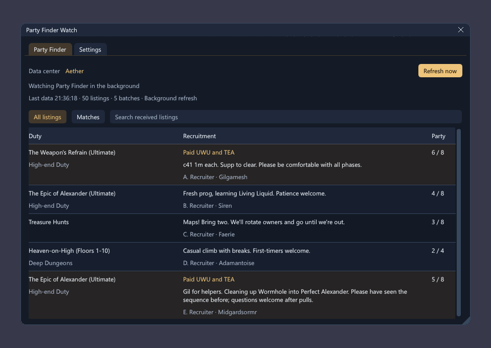

# Party Finder Watch

**Get an in-game alert when an FFXIV Party Finder listing matches what you’re looking for.** Save watches for specific duties, whole categories, or keywords, and let them run from a draggable badge while you play.

## Install in Dalamud

Use [XIVLauncher](https://goatcorp.github.io/) with Dalamud enabled.

1. In FFXIV, type `/xlsettings` and open **Experimental → Custom Plugin Repositories**.
2. Paste this repository URL, click **+**, make sure its checkbox is enabled, and save.

   ```text
   https://raw.githubusercontent.com/lividdarling-cmyk/PartyFinderWatch/main/repo.json
   ```

3. Type `/xlplugins`, find **Party Finder Watch** under **Available Plugins**, and click **Install**.
4. On first launch, pick one or more starter presets or choose **Start empty**. The **Quick tour** walks you through the window. Use `/pfwatch` to open it any time.




## How it works

- **Browse or filter.** Use **All listings** to browse the results your client received and **Matches** to see what your watches found. The scope follows the logical data center of your current world, such as Aether or Primal, and resets when you switch data centers.
- **Refresh while you play.** Use **Refresh now** or set an automatic interval. Background refresh can run while native Party Finder is closed. Refresh pauses during duties and area transitions.
- **Keep the badge visible.** Close the window to its draggable badge. A new match plays your selected sound and leaves a **!** until you open the badge. Hover to see your current data center and unread count.
- **Manage watches locally.** Use **Settings → Add presets** or **+ Add watch**. Your matches and settings are processed on your PC.

## Watches

On first run, pick any combination of preset groups or **Start empty**, then follow the **Quick tour**. Use **Settings → Add presets** to add more starter watches later. Each preset becomes an independently editable watch.

| Preset | Matches |
| --- | --- |
| **Paid clears** | High-end Duty with a clear term such as `c41`, `a2c`, or `supp to clear`, plus a gil offer. |
| **Paid prog and lockouts** | High-end Duty with `prog`, `cleanup`, `lockout`, or similar language, plus a gil offer. |
| **Treasure hunts** | Any listing under Treasure Hunts, including listings without a description. |
| **Social venues** | Event and venue terms such as `live DJ`, `cafe`, `tavern`, and `open stage` under Other. |
| **Venue hiring** | Phrases like `hiring`, `job openings`, and `looking for staff` under Other. |


Use **Settings** to save independent watches for all Party Finder listings, a category, or selected duties. Add keywords or phrases with **+** or paste comma-separated terms. One keyword match is enough. Matching ignores letter case and surrounding punctuation. **Require a gil offer** adds a separate payment check. Leaving keywords blank matches any listing within the chosen scope and payment requirements.

Use the sound dropdown in **Settings** to select one of FFXIV's built-in chat sounds (`<se.1>`–`<se.16>`). **Preview sound** plays the selected sound locally. Turn off **Play a sound for new matches** to mute automatic alerts.

## Troubleshooting

- **Plugin missing from the installer.** Check that the raw `repo.json` URL is enabled under **Custom Plugin Repositories**. Reopen `/xlplugins` and check that your Dalamud version is compatible with the release.
- **Listings are slow to appear.** Check the **Last data** timestamp and use **Refresh now** outside a duty. If needed, open native Party Finder on **Data Center → All** and refresh there. The plugin shows the pages your client receives, and extra pages can be browsed in native Party Finder. A listing that fills or closes early may stay visible until its timer expires.
- **No sound.** Check **Play a sound for new matches** and try **Preview sound** in Settings.

For a problem or feature request, [open a GitHub issue](https://github.com/lividdarling-cmyk/PartyFinderWatch/issues). Include the plugin version, game patch, data center, and steps to reproduce it.
